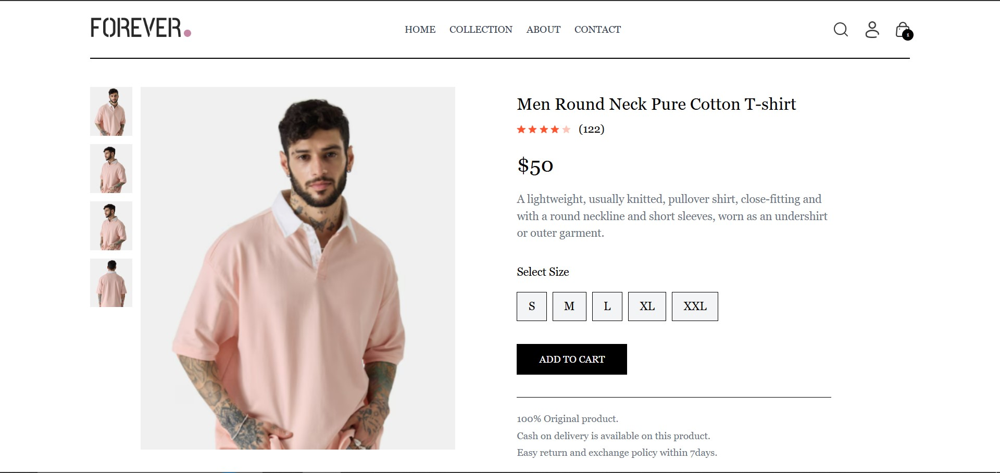
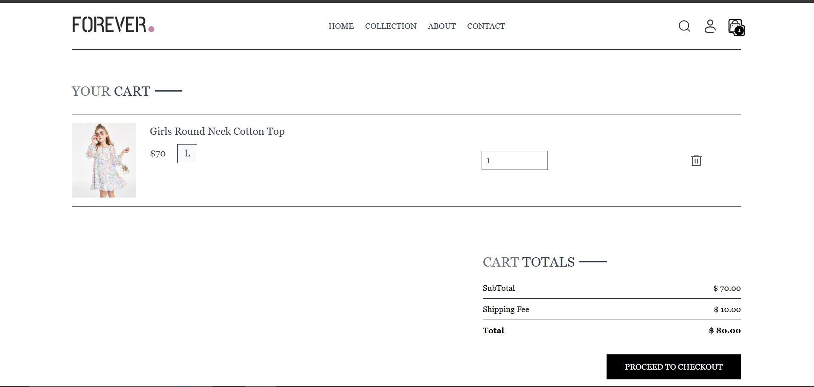
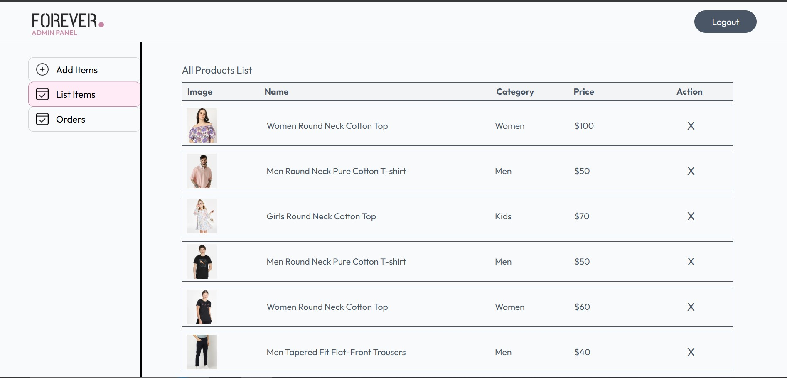
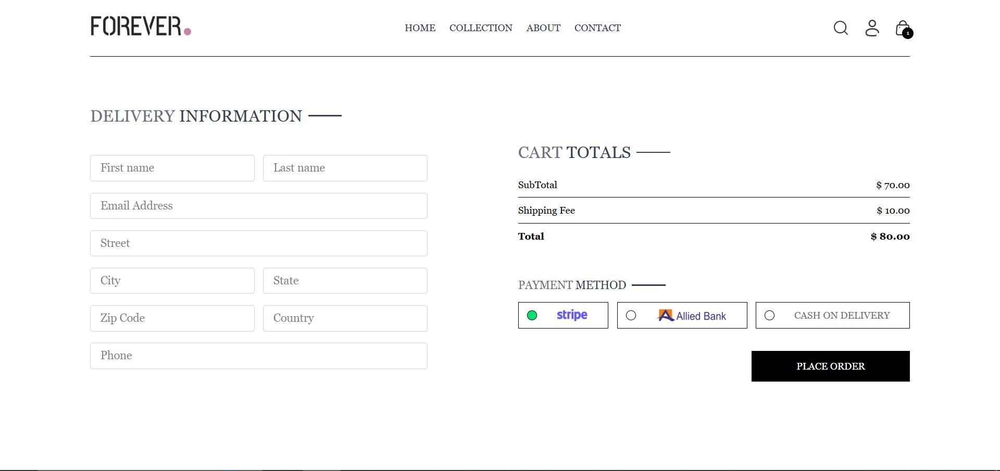
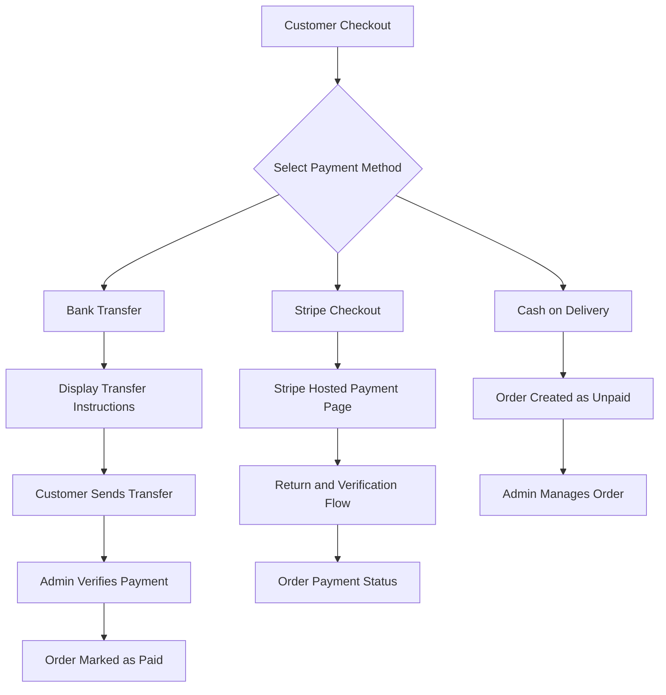
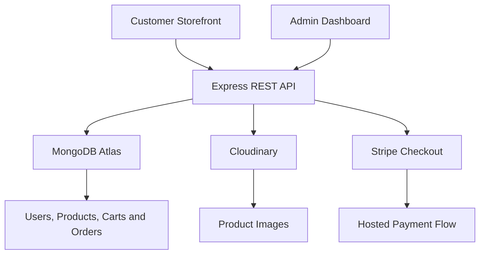

# FOREVER — Full-Stack E-Commerce Platform

A full-stack fashion e-commerce application built with the MERN stack. FOREVER features a customer storefront, a separate admin dashboard, JWT authentication, persistent shopping carts, product management with multiple image uploads, order tracking, and three payment methods: Stripe Checkout, Bank Transfer, and Cash on Delivery.

## Screenshots

### 1. Homepage


The storefront displays the latest arrivals and product collections through a clean, responsive interface.

### 2. Product Details



Customers can explore product details, select sizes, and add products to their shopping cart. Products support multiple images, with up to five images configurable through the admin dashboard. Selecting a thumbnail updates the main product image.

### 3. Shopping Cart



Customers can review selected products, change quantities, remove items, and view subtotal, shipping fees, and the final order total.

### 4. Admin Dashboard



The admin dashboard supports product creation, multiple image uploads, category and subcategory selection, pricing, size selection, product listing, and order management.

### 5. Checkout



Customers enter their delivery information and choose between Stripe, Bank Transfer, and Cash on Delivery.

## Key Features

### Customer Storefront

- Browse product collections and search for products.
- View product details, descriptions, prices, sizes, and image galleries.
- Switch the main product image by selecting a thumbnail.
- Discover related products.
- Register and log in using JWT authentication.
- Maintain a persistent shopping cart linked to the user's account.
- Update product quantities, select sizes, and remove cart items.
- View order totals, including shipping fees.
- Place orders using supported payment methods.
- View order history, payment information, and delivery status.
- Track order status through the customer dashboard.
- Receive toast notifications and loading-state feedback.
- Use the responsive interface on different screen sizes.

### Admin Dashboard

- Separate admin login and authentication.
- Add new products with multiple images uploaded to Cloudinary.
- Upload up to five product images per product.
- Configure product names, descriptions, prices, categories, subcategories, and sizes.
- View and remove products.
- View customer orders and associated order information.
- Review payment methods and payment statuses.
- Update order delivery statuses.
- Manually verify Bank Transfer payments and mark eligible orders as paid.

### Authentication and Data Management

- JWT-based customer authentication.
- Separate admin authentication middleware.
- MongoDB persistence for users, products, carts, and orders.
- Account-based cart persistence across sessions and devices.
- Protected customer and admin API routes.

## Payment Methods

FOREVER supports three checkout options.

| Payment method | Workflow |
|---|---|
| Cash on Delivery | The order is created as unpaid and can be managed through the admin dashboard. |
| Stripe Checkout | The customer is redirected to Stripe's hosted checkout page. The payment flow includes a return and verification page. |
| Bank Transfer | The customer receives transfer instructions, the order reference, and a calculated PKR transfer amount. An admin manually verifies the payment. |

### Bank Transfer with PKR Conversion

The application can display the order total in USD alongside the equivalent transfer amount in PKR.

- The exchange rate is configurable through the `USD_TO_PKR` environment variable.
- The order ID is provided as the payment reference.
- Bank account information is configured through environment variables.
- An admin can manually verify the transfer and mark the order as paid.

The exchange rate is configurable rather than automatically fetched from a live currency service.

### Payment Flow



> **Payment security:** A successful redirect to a payment return page should not, by itself, be treated as proof of payment. Before using this application for real transactions, implement and verify server-side Stripe payment confirmation using the Checkout Session status or signed webhooks. Ensure the server validates payment amounts and order ownership.

## Technology Stack

| Layer | Technologies |
|---|---|
| Customer Frontend | React, Vite, React Router, Context API, Tailwind CSS |
| Admin Frontend | React, Vite, React Router, Tailwind CSS |
| HTTP Requests | Axios |
| Notifications | React Toastify |
| Backend | Node.js, Express.js |
| Database | MongoDB Atlas, Mongoose |
| Authentication | JSON Web Tokens (JWT) |
| Image Storage | Cloudinary |
| Payment Processing | Stripe Checkout |
| Deployment | Vercel |

## Project Architecture

The application consists of three separate applications.



The customer storefront and admin dashboard communicate with the backend through REST API endpoints. The backend handles application logic and database operations, while Cloudinary stores product images and Stripe provides hosted checkout.

## Project Structure

```text
E-Commerce-App/
├── frontend/
│   └── src/
│       ├── assets/
│       ├── components/
│       ├── context/
│       └── pages/
│
├── admin/
│   └── src/
│       └── pages/
│           ├── Add
│           ├── List
│           └── Orders
│
├── backend/
│   ├── config/
│   ├── controllers/
│   ├── middleware/
│   ├── models/
│   ├── routes/
│   └── server.js
│
└── docs/
    └── images/
        ├── homepage.png
        ├── product-details.png
        ├── cart.png
        ├── admin-dashboard.png
        └── checkout.png
```

> This is a representative structure. Keep the directory and file names aligned with the actual repository.

## API Documentation

Customer routes use a JWT token supplied in the `token` request header, where required. Admin routes require valid admin authentication.

### User Routes

| Method | Endpoint | Access | Description |
|---|---|---|---|
| POST | `/api/user/register` | Public | Register a customer |
| POST | `/api/user/login` | Public | Authenticate a customer and receive a token |

### Product Routes

| Method | Endpoint | Access | Description |
|---|---|---|---|
| GET | `/api/product/list` | Public | Retrieve products |
| POST | `/api/product/add` | Admin | Add a product and upload images |
| POST | `/api/product/remove` | Admin | Remove a product |

### Cart Routes

| Method | Endpoint | Access | Description |
|---|---|---|---|
| POST | `/api/cart/add` | Customer | Add an item to the cart |
| POST | `/api/cart/update` | Customer | Update an item quantity |
| POST | `/api/cart/get` | Customer | Retrieve the saved cart |

### Order Routes

| Method | Endpoint | Access | Description |
|---|---|---|---|
| POST | `/api/order/place` | Customer | Create a Cash on Delivery order |
| POST | `/api/order/stripe` | Customer | Create a Stripe Checkout session |
| POST | `/api/order/verifyStripe` | Customer | Process the Stripe return and verification flow |
| POST | `/api/order/bank` | Customer | Create a Bank Transfer order |
| POST | `/api/order/userorders` | Customer | Retrieve the customer's orders |
| POST | `/api/order/list` | Admin | Retrieve all orders |
| POST | `/api/order/status` | Admin | Update an order's delivery status |
| POST | `/api/order/markpaid` | Admin | Mark a bank transfer order as paid |

## Getting Started

### Prerequisites

Install or prepare the following before running the application:

- Node.js 18 or newer.
- npm.
- A MongoDB Atlas database or compatible MongoDB instance.
- A Cloudinary account.
- A Stripe account with test-mode API keys.

### 1. Clone the Repository

Replace the URL below with the actual GitHub repository URL.

```bash
git clone <YOUR_GITHUB_REPOSITORY_URL>
cd E-Commerce-App
```

### 2. Install Dependencies

Open a terminal in the project root and install the dependencies for each application.

```bash
cd backend
npm install

cd ../frontend
npm install

cd ../admin
npm install
```

### 3. Configure Environment Variables

Create the appropriate `.env` files in each application directory.

#### Backend — `backend/.env`

| Variable | Description |
|---|---|
| `PORT` | Backend port; defaults to `4000` |
| `MONGODB_URI` | MongoDB connection string |
| `JWT_SECRET` | Secret used to sign JWTs |
| `ADMIN_EMAIL` | Admin login email |
| `ADMIN_PASSWORD` | Admin login password |
| `CLOUDINARY_NAME` | Cloudinary cloud name |
| `CLOUDINARY_API_KEY` | Cloudinary API key |
| `CLOUDINARY_SECRET_KEY` | Cloudinary API secret |
| `STRIPE_SECRET_KEY` | Stripe test-mode secret key |
| `BANK_NAME` | Bank name displayed during transfer |
| `BANK_ACCOUNT_TITLE` | Bank account title |
| `BANK_ACCOUNT_NUMBER` | Demo bank account number |
| `BANK_IBAN` | Demo bank IBAN |
| `USD_TO_PKR` | Configured USD-to-PKR conversion rate |

Example:

```env
PORT=4000
MONGODB_URI=your_mongodb_connection_string
JWT_SECRET=your_strong_jwt_secret

ADMIN_EMAIL=your_admin_email
ADMIN_PASSWORD=your_secure_admin_password

CLOUDINARY_NAME=your_cloudinary_name
CLOUDINARY_API_KEY=your_cloudinary_api_key
CLOUDINARY_SECRET_KEY=your_cloudinary_api_secret

STRIPE_SECRET_KEY=sk_test_your_stripe_secret_key

BANK_NAME=Demo Bank
BANK_ACCOUNT_TITLE=Demo Account
BANK_ACCOUNT_NUMBER=demo_account_number
BANK_IBAN=demo_iban

USD_TO_PKR=280
```

Use your own values locally. The exchange rate above is an example, not a live market rate.

#### Customer Frontend — `frontend/.env`

```env
VITE_BACKEND_URL=http://localhost:4000
```

#### Admin Frontend — `admin/.env`

```env
VITE_BACKEND_URL=http://localhost:4000
```

Use the appropriate deployed API URL when configuring production environments.

> **Security:** Never commit `.env` files, API secrets, JWT secrets, private credentials, or real bank account information to GitHub. Client-side variables prefixed with `VITE_` are exposed to the browser and must not contain secrets.

### 4. Start the Applications

Run each application in a separate terminal.

**Backend**

```bash
cd backend
node server.js
```

Default local address: `http://localhost:4000`

**Customer storefront**

```bash
cd frontend
npm run dev
```

Default Vite address: `http://localhost:5173`

**Admin dashboard**

```bash
cd admin
npm run dev
```

Default Vite address: `http://localhost:5174`

Vite may choose a different port if the default is already occupied.

## Testing the Payment Flows

### Stripe Test Mode

1. Add products to the cart and proceed to checkout.
2. Select Stripe.
3. Use the following standard Stripe test card in the hosted checkout.

| Field | Test value |
|---|---|
| Card number | `4242 4242 4242 4242` |
| Expiry date | Any valid future date |
| CVC | Any valid three-digit CVC |

4. Complete the test checkout and inspect the application's return and order-verification behavior.

Use only Stripe test mode and test credentials. Confirm that server-side payment verification is implemented before treating payment status as authoritative.

### Bank Transfer

1. Select Bank Transfer at checkout.
2. Review the displayed bank details, order reference, and PKR transfer amount.
3. Open the admin dashboard and navigate to Orders.
4. Use **Mark as paid** to record a manually verified demo transfer.

The bank information should remain dummy data in the public demo.

### Cash on Delivery

1. Select Cash on Delivery at checkout.
2. Place the order.
3. Open the admin dashboard to inspect the order and update its delivery status.

## Security and Production Considerations

This project demonstrates full-stack e-commerce workflows, but additional work is needed before handling real customer transactions.

- Verify Stripe payments server-side using validated Checkout Session details or signed webhooks.
- Recalculate product prices, shipping fees, and order totals on the backend using trusted database values.
- Validate user input and enforce authorization on every protected endpoint.
- Prevent unauthorized users from viewing or modifying other customers' orders.
- Protect administrator credentials and use secure secret management in deployment.
- Validate payment status transitions and prevent duplicate payment processing.
- Configure appropriate CORS policies and production environment variables.
- Avoid exposing sensitive customer or payment information in logs and responses.

## Future Improvements

- Implement reliable Stripe webhook-based payment confirmation.
- Strengthen server-side price and order-total validation.
- Integrate a live currency exchange-rate service.
- Add order confirmation and payment notification emails.
- Support payment-proof uploads for Bank Transfer orders.
- Add pagination and filtering to the admin orders dashboard.
- Introduce product reviews and ratings.
- Expand automated testing for authentication, cart operations, orders, and payment flows.

## Author

**Atta-Ur-Rahman**  

---

*Built as a full-stack e-commerce portfolio project to practice frontend development, REST API design, database integration, authentication, image uploads, order management, and payment workflows.*
